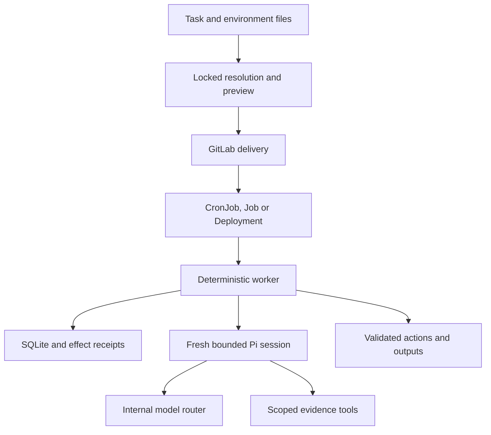

# Sentinel Pi architecture

This implements the small-worker architecture developed in design revision v0.2.
`README.md` and the code describe the current executable contract. Site-specific
bindings and live production acceptance remain the operator's responsibility.

## Runtime and task separation

One pinned Node/Pi image and one chart serve all tasks. Immutable task bundles
contain YAML, a lockfile, selected instructions/skills and optional reviewed
TypeScript. Recipes are versioned within the runtime image. A dependency or shared
adapter change requires a runtime build; ordinary task changes require deployment
only.

## Outer and inner loops

The worker discovers evidence, persists changed work, applies time/usage limits,
starts a bounded session, validates its result, rechecks source eligibility,
performs permitted effects and records completion. Continuous execution uses
fixed idle delays with jitter and exponential outage backoff. It does not overlap
cycles. The interval is not a strict observation-latency guarantee under backlog.

Pi reasons only about one item. Selected read tools and `submit_result` are its
entire model-visible interface. Ambient CLI tools/configuration are disabled.
Sessions use in-memory context with compaction, automatic retry and cache warming
disabled. Conservative input estimates and request/output caps bound each call.
Unknown/failed usage retains its reservation rather than being treated as free.

Custom flows can perform multiple bounded sessions using the same per-item and
cycle counters. Custom tools require a declared read manifest and output/timeout
bounds. All task code is trusted; it is not sandboxed within the process.

## Authoring and resolution

Recipes supply defaults. Task files supply explicit overrides and resource paths.
Environment files supply named connections, model profiles and policy ceilings.
Unknown fields fail validation. Lists replace defaults rather than concatenate.
The resolved behavior/resource hashes are committed to `task.lock.json`; CI does
not silently update them. `explain` reports sources of defaults and effective
scope without resolving credential values.

The lockfile binds the environment's endpoint/model/scope configuration too.
Changing bindings requires intentional resolution. The Kubernetes image is pinned
separately by its actual registry digest in Helm values; self-reporting a package
version is not a substitute for deployment image integrity.

## Source adapters

GitLab discovery reconciles all open issues with the exact configured labels.
It excludes bot/system notes from content identity and gathers bounded linked
references and available parent-epic context. Repository reads specify project,
path and Git reference; those dependencies are revalidated on later discovery.
Inaccessible/truncated references make coverage partial.

Kubernetes discovery reads selected namespaces. It queues sustained known failure
states and observes recovery for previously recorded pods. Owner status, events
and capped logs support diagnosis. Pod specs/environment values are not exposed
as generic evidence. Capacity/Pending diagnostics beyond the explicit failure
states need a dedicated detector before being treated as actionable incidents.

Prometheus queries are operator-configured and evaluated over completed windows.
Named results are exposed to the model; it cannot author arbitrary PromQL. Local
calendar windows account for DST; a bounded set of missed windows is reconciled.

## State and effects

SQLite uses a block-storage PVC, never a shared multiworker RWX database. The Linux
entry point holds `flock` for the worker process. Cron `Forbid` and Deployment
`Recreate` reduce overlap, while filesystem locking/storage fencing remain
deployment prerequisites.

Work identities distinguish source content from task behavior revisions. A task
rollout does not requeue unchanged completed items. New source content queues a
review; explicit reprocess supports intentional backlog work. Failed outputs
retain a validated candidate so delivery retries can avoid more inference.

An effect intent is written before mutation. GitLab publication reconciles one
bot-owned note through a stable marker. Repair reconciliation checks the intended
annotation and target UID before repeating anything. There is no transaction
across SQLite and a remote API, so delivery is at least once with reconciliation,
not a claim of distributed exactly-once execution.

The namespace restart playbook requires an opted-in stateless Deployment, exact
connection/task scope, at least two replicas, observed generation, available
capacity, zero rollout unavailability and positive surge. It uses a JSON Patch
with UID/resourceVersion tests, then checks observed rollout availability.
Cooldowns persist independently of an individual pod identity. Overlapping
repair ownership across independent tasks is prohibited in this singleton design.

## Output and preview

Results are schema-validated, evidence references must exist, and a custom tool
does not directly publish. GitLab quick-action lines are quoted before posting.
The worker rechecks an issue before publication; concurrent edits can still race
with the Notes API, so the report identifies its reviewed evidence revision.

Preview uses isolated state, a read-only source client and disabled normal output/
repair execution. It returns JSON, Markdown and escaped standalone HTML. Live
preview uses separately provisioned read credentials. Trusted custom code still
requires review because it can bypass host helpers at OS level.

## Kubernetes delivery

One task per release, one active worker per task. The ConfigMap is created before
Helm deployment, references include content identity, and older packages must be
retained for rollback. The PVC is retained on uninstall. Runtime Secrets and CA
bundles are supplied by existing platform mechanisms or optional ESO configuration.

The chart supplies non-root execution, dropped capabilities, read-only root
filesystem, scratch volume, resources, explicit network isolation and scoped RBAC.
Continuous workers expose health/readiness and scrape metrics. Short-lived Jobs
use exit state plus structured logs; they do not pretend to offer durable scrape
metrics after process exit. Deadline validation accounts for startup, processing
and termination allowances.

## Included implementation and further work

Included: recipes, locked schema resolution, init/validate/explain/doctor, fixture/
live previews, report rendering, custom flows/read tools, three source adapters,
one repair playbook, note reconciliation, durable state, image definition, chart,
generic GitLab pipeline and GitHub validation/container workflows.

Operator validation still required: real router/model tool behavior and quality,
source-version compatibility, bot access, CA trust, CNI rules, PVC lock/fencing,
image build/scanning, rollout policy and production workload acceptance.

Deferred infrastructure: distributed workers/Postgres arbitration, webhook
receiver, independent recipe marketplace, arbitrary workflow DSL and dashboard
backend. GitLab and Grafana remain the initial operator interfaces. The local
status command reads worker state; it is not a remote fleet-control API.

Primary interfaces: [Pi SDK](https://pi.dev/docs/latest/sdk),
[CronJobs](https://kubernetes.io/docs/concepts/workloads/controllers/cron-jobs/),
[GitLab Issues](https://docs.gitlab.com/api/issues/),
[GitLab Notes](https://docs.gitlab.com/api/notes/).
